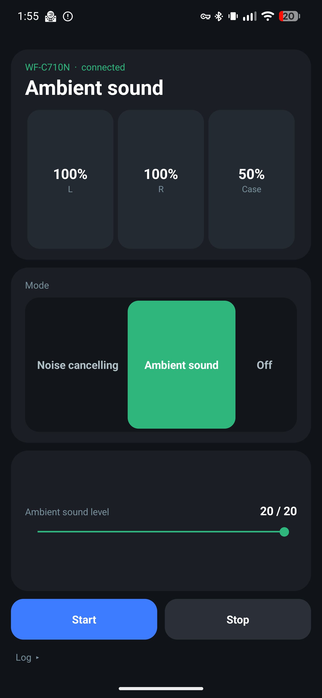
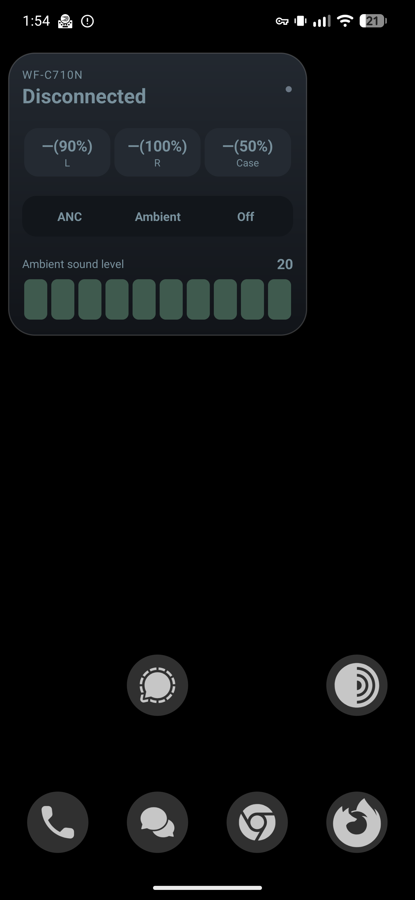
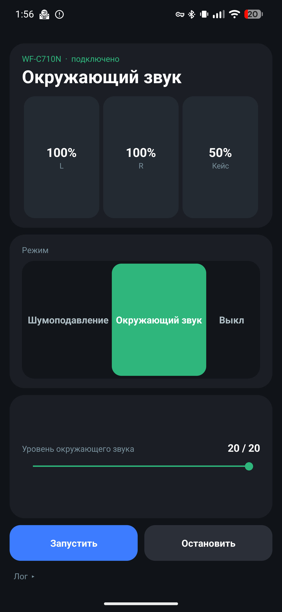
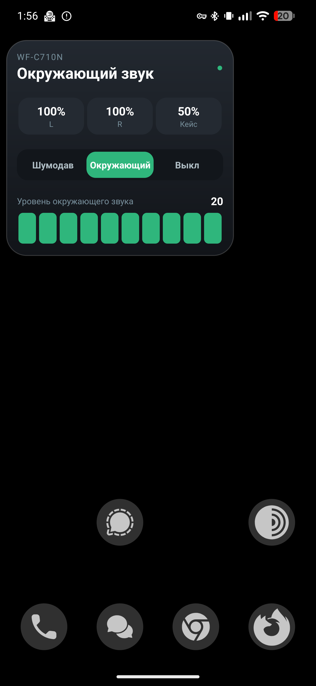
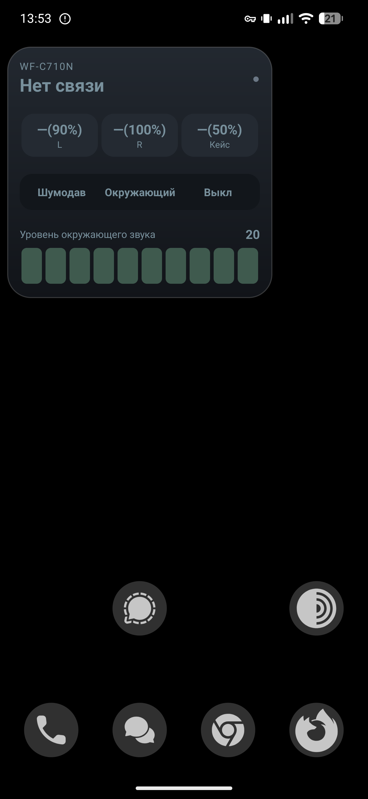

# sony wf-c710n battery widget
Sony WF-C710N battery and modes widget

[English](#english) | [Русский](#русский)

## English

An app that shows the earbuds' mode (noise cancelling, ambient sound, off) and the battery level of the earbuds and the case. You can also adjust the ambient sound level right from the widget.

### Screenshots

| App | Widget — connected | Widget — disconnected |
|---|---|---|
|  |  |  |

### Features

- Battery: left, right and case (last known value is shown as `—(80%)` when a bud is out of reach)
- Noise cancelling / Ambient sound / Off — switch from the widget or the app
- Ambient sound level 0–20 (slider in the app, tap bar in the widget)
- Auto-reconnect: 3×3 s, 2×5 s, 1×15 s, then waits until the earbuds connect over Bluetooth again
- English and Russian UI (follows the system language)
- No internet, no accounts, no analytics. Permissions: Bluetooth connect, notifications, foreground service.

> Tested on WF-C710N firmware 1.0.5 (Android 17). Other Sony earbuds that speak the same
> "V2" protocol *might* work, but are untested. The app picks the first paired device whose name contains
> `C710` (or `WF-`).

### Install

1. Download the APK from [Releases](../../releases) and install it (allow installing unknown apps).
2. Open **Buds Widget**, tap **Start**, allow Bluetooth and notification permissions.
3. Long-press the home screen → Widgets → **Buds Widget**.

**Important:** only one app can hold the earbuds' control channel. If the connection fails, force-stop
Sony | Sound Connect and tap Start again.

The ambient level can only be changed while the earbuds are in ambient mode — that's how the earbuds behave.

### Bugs
```
13:48:02 connected to WF-C710N
13:48:03 init OK
13:48:03 battery: L —(90%)   R 100%   Case —(50%)
13:48:03 read error: bt socket closed, read return: -1
13:48:03 disconnected
13:48:03 retry 1/6 in 3s
```
I still haven't figured out why, but the first connection attempt always fails, and the second one always works fine.

### Build

No Gradle, no Android Studio — one shell script:

```sh
# needs: JDK 17+, kotlinc, Android build-tools (aapt, zipalign, apksigner, d8), android.jar (API 34)
KOTLINC=/path/to/kotlinc ANDROID_JAR=/path/to/android.jar ./build.sh
# -> build/BudsWidget.apk  (signed with ./release.jks, created on first run — keep it for updates)
```

`android.jar` can be taken from your Android SDK (`platforms/android-34/android.jar`).

### Protocol (WF-C710N, fw 1.0.5)

Bluetooth Classic RFCOMM, service UUID `956C7B26-D49A-4BA8-B03F-B17D393CB6E2`.

Frame: `3e <escaped(type seq len32be payload checksum)> 3c`; `3c/3d/3e` inside are escaped as `3d, byte & 0xef`;
checksum = sum of bytes & 0xff. Every non-ACK frame must be acknowledged (type `01`, seq flipped).

| What | Send (type `0c`) | Reply / notification |
|---|---|---|
| Init | `00 00` | `01 00 03 00 30 00 00 00` |
| Battery L/R | `22 09` | `23 09 L chg R chg …` (notify `25 09 …`; 0 % = bud not reachable) |
| Battery case | `22 0a` | `23 0a lvl chg …` (only while the case is open) |
| Get ANC/ambient | `66 17` | `67 17 01 f1 f2 voice level` (notify `69 17 …`) |
| Set ANC/ambient | `68 17 01 f1 f2 voice level` | ACK, then `69 17 …` |

`f1=0` off · `f1=1 f2=0` noise cancelling · `f1=1 f2=1` ambient sound · level `0..20`.
Full details are in [`src/Protocol.kt`](src/Protocol.kt).

### Code map

| File | What |
|---|---|
| `src/Protocol.kt` | frame codec, state, parsers, command builder (pure Kotlin) |
| `src/SonyClient.kt` | RFCOMM connection, ACK handshake, reading replies |
| `src/SonyService.kt` | foreground service, reconnect schedule |
| `src/Control.kt` | commands from widget / UI |
| `src/StatusWidget.kt` | home-screen widget |
| `src/MainActivity.kt` | main screen |
| `src/Store.kt`, `src/Format.kt`, `src/Util.kt` | state, log, formatting, helpers |

### Contributing
Fully open source, all the code is published. Pull requests are welcome!

### Credits

Useful references while reverse-engineering: [Gadgetbridge](https://codeberg.org/Freeyourgadget/Gadgetbridge)
(Sony headphones support), SonyHeadphonesClient, tthayer/sony-wf-control-app.

Not affiliated with or endorsed by Sony. "Sony" and "WF-C710N" are trademarks of their owners. Use at your own risk. Licensed under [MIT](LICENSE).

## Русский

Приложение для отображения режима наушников (шумоподавление, окружающий звук, выкл), заряда наушников и кейса. Также через виджет можно менять громкость окружающего звука.

### Скриншоты

| Приложение | Виджет — подключено | Виджет — нет связи |
|---|---|---|
|  |  |  |

### Возможности

Заряд левого, правого и кейса, переключение шумоподавления / окружающего звука / выкл, уровень окружающего
звука 0–20, автопереподключение. Работает без приложения Sony | Sound Connect. Интерфейс на русском или английском — по языку системы.

### Установка

Скачать APK из [Releases](../../releases), открыть приложение, нажать «Запустить», дать разрешения,
добавить виджет на рабочий стол.

**Если не подключается:** закрыть (остановить) Sound Connect — управлять наушниками одновременно может
только одно приложение. Уровень окружающего звука меняется только в режиме «Окружающий звук».

### Баги
```
13:48:02 connected to WF-C710N
13:48:03 init OK
13:48:03 battery: L —(90%)   R 100%   Кейс —(50%)
13:48:03 read error: bt socket closed, read return: -1
13:48:03 disconnected
13:48:03 retry 1/6 in 3s
```
Я так и не понял почему, но с первого раза всегда ошибка, а со второго всё окей.

### Сборка и протокол

Сборка (`build.sh`), описание протокола и карта кода — в [английском разделе](#build).

### Участие
Всё open source, весь код выложен. Предлагайте пулл-реквесты, буду рад!
